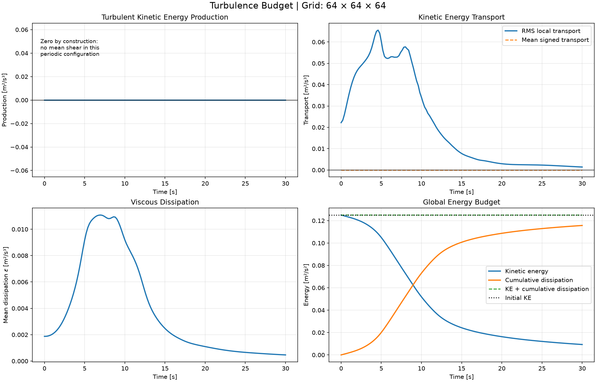
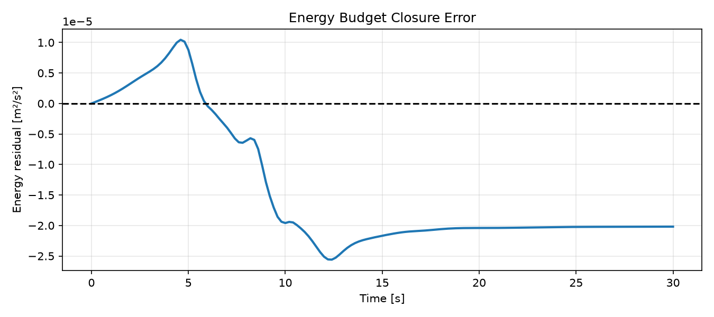
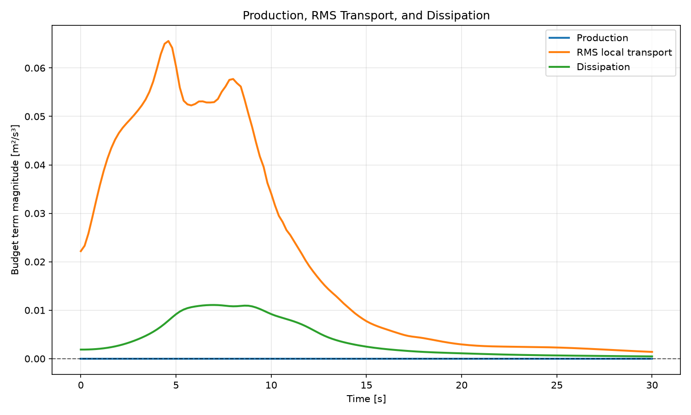

# turbulence-simulation

Simulating turbulent flows in 2D and 3D and mapping out their energy transfer (APC 524 final project).

This repository contains a three-dimensional Taylor-Green vortex Direct Numerical Simulation (DNS) on a pseudo-spectral method, plus a `postprocessing` package that reduces a saved velocity field `u(x, y, z, t)` into the **resolved kinetic-energy budget**: production, transport and dissipation, with a global energy-closure diagnostic.

## Contents

- [Repository layout](#repository-layout)
- [Environment setup](#environment-setup)
- [Quickstart](#quickstart)
- [Postprocessing API](#postprocessing-api)
- [Example notebook](#example-notebook)
- [Example figures](#example-figures)
- [Large data files](#large-data-files)
- [Running the tests](#running-the-tests)
- [Numerical assumptions and limitations](#numerical-assumptions-and-limitations)
- [Physical model](#physical-model)
- [Contributing](#contributing)
- [License](#license)

## Repository layout

| Path | What it is |
|---|---|
| `postprocessing/turbulence_budget.py` | The energy-budget analysis module (`plot_turbulence_budget`). |
| `postprocessing/__init__.py` | Re-exports the public function so you can `from postprocessing import plot_turbulence_budget`. |
| `Turb_Dissipation_simulation.ipynb` | Example notebook: runs the DNS, then calls the module. Self-contained - it generates its own data. |
| `figures/` | Example output images (regenerate with the notebook, see below). |
| `tests/test_turbulence_budget.py` | Pytest suite: input validation, exact periodic identities, and a short DNS closure check. |
| `requirements.txt` | Direct runtime dependencies (version floors). |
| `requirements-dev.txt` | Optional tooling: Jupyter, pytest, pre-commit hooks. |
| `requirements-lock.txt` | Exact `pip freeze` of the environment used to produce `figures/`. Provenance only - do not install this for normal use. |
| `conftest.py` | Makes `import postprocessing` work in tests without an install step. |
| `.pre-commit-config.yaml` | Hooks that strip notebook outputs and refuse oversized files. |

## Environment setup

### Requirements

- Python 3.10 or newer
- pip
- NumPy, SciPy, Matplotlib (installed in step 4)

### 1. Clone the repository

```bash
git clone https://github.com/jliu2005/turbulence-simulation.git
cd turbulence-simulation
```

### 2. Create a virtual environment

```bash
python3 -m venv .venv
```

### 3. Activate the environment

macOS / Linux:

```bash
source .venv/bin/activate
```

Windows:

```bat
.venv\Scripts\activate
```

### 4. Install dependencies

```bash
python -m pip install --upgrade pip
python -m pip install -r requirements.txt
```

For notebook development and the test suite (optional):

```bash
python -m pip install -r requirements-dev.txt
pre-commit install
```

### 5. Configure Jupyter

```bash
python -m ipykernel install --user --name=taylor-green --display-name "Python (Taylor-Green)"
```

Open the notebook in VS Code or Jupyter and select **Python (Taylor-Green)** as the kernel.

### 6. Verify the environment

```bash
python --version
python -c "from postprocessing import plot_turbulence_budget; print('ok')"
python -m pytest -q
```

The virtual environment and all simulation output files are excluded from version control. Dependencies are documented in `requirements.txt` and installed locally by each contributor.

## Quickstart

The notebook does all of this, but the analysis is a regular Python function and can be used from any script:

```python
import numpy as np
from postprocessing import plot_turbulence_budget

# A velocity field with shape (nt, 3, nx, ny, nz), components ordered [u, v, w].
# Get one by running the DNS in Turb_Dissipation_simulation.ipynb, or from your
# own solver as long as the grid is uniform and triply periodic.
velocity = ...          # float32 or float64, shape (nt, 3, nx, ny, nz)
times = ...             # shape (nt,) in seconds, strictly increasing
nu = 1 / 400            # kinematic viscosity
domain_lengths = (2 * np.pi, 2 * np.pi, 2 * np.pi)

results, fig, axes = plot_turbulence_budget(
    velocity=velocity,
    nu=nu,
    times=times,
    domain_lengths=domain_lengths,
    component_axis=1,
    dealias=True,
    show=True,
)

print(results["KE"][0], results["dissipation"].max())
```

If you would rather not store the snapshots in memory, note that `velocity` is indexed along axis 0 only, so a memory-mapped or lazily generated array of the same shape also works.

## Postprocessing API

### `plot_turbulence_budget(...)`

```python
results, fig, axes = plot_turbulence_budget(
    velocity,
    nu,
    dt=None,
    times=None,
    domain_lengths=(2 * np.pi, 2 * np.pi, 2 * np.pi),
    component_axis=1,
    dealias=True,
    show=True,
    save_prefix=None,
)
```

#### Parameters

| Name | Type | Default | Meaning |
|---|---|---|---|
| `velocity` | `np.ndarray` | required | Velocity snapshots in physical space, shape `(nt, 3, nx, ny, nz)`, or `(nt, nx, ny, nz, 3)` with `component_axis=-1`. Components ordered `[u, v, w]`. |
| `nu` | `float` | required | Kinematic viscosity, m²/s. Must be non-negative. |
| `dt` | `float` | `None` | Time between snapshots, s. Required if `times` is not given. |
| `times` | `np.ndarray` | `None` | Explicit snapshot times, s. Use instead of `dt` for irregular sampling. Must be strictly increasing. |
| `domain_lengths` | `tuple` | `(2π, 2π, 2π)` | Physical domain size `(Lx, Ly, Lz)`, m. Assumes a uniform periodic Cartesian grid. |
| `component_axis` | `int` | `1` | Axis holding the three velocity components. |
| `dealias` | `bool` | `True` | Apply the 2/3-rule spectral filter to the velocity and to all nonlinear products. |
| `show` | `bool` | `True` | Call `plt.show()`. Set `False` in scripts and tests. |
| `save_prefix` | `str` | `None` | Write `<prefix>budget.png`, `<prefix>closure.png`, `<prefix>terms.png` at 150 dpi. |

#### Returns

`results` is a dictionary of 1-D arrays, one value per snapshot:

| Key | Quantity | Units |
|---|---|---|
| `times` | Snapshot times | s |
| `KE` | Domain-mean resolved kinetic energy, $K = \tfrac{1}{2}\left(u^2 + v^2 + w^2\right)$ | m²/s² |
| `production` | Production by mean shear - **identically zero for this configuration**, see [limitations](#numerical-assumptions-and-limitations) | m²/s³ |
| `transport_mean` | Signed domain mean of the transport term (a periodic-domain diagnostic: this should be ~0) | m²/s³ |
| `transport_rms` | RMS of the transport term - the physically meaningful transport magnitude | m²/s³ |
| `dissipation` | $\epsilon = 2 \nu S_{ij} S_{ij}$ | m²/s³ |
| `cumulative_dissipation` | Trapezoidal time integral of $\epsilon$ | m²/s² |
| `energy_budget_residual` | $KE + \int \epsilon\,dt - KE(0)$, i.e. the closure error | m²/s² |
| `figures` | Dict of the three matplotlib figures: `budget`, `closure`, `terms` | - |

`fig` and `axes` are the four-panel budget figure and its axes, for further styling.

#### Definitions used

Dissipation:

$$
\epsilon = 2 \nu S_{ij} S_{ij}, \qquad S_{ij} = \tfrac{1}{2}\left(\partial_j u_i + \partial_i u_j\right)
$$

Transport (pressure transport plus viscous diffusion):

$$
T = -\nabla \cdot \left[(K + p)\,\mathbf{u}\right] + \nu \nabla^2 K
$$

Kinetic energy:

$$
K = \tfrac{1}{2}\left(u^2 + v^2 + w^2\right)
$$

The pressure is obtained from a spectral Poisson solve of $\nabla^2 p = -\partial_i u_j\, \partial_j u_i$ with the $k = 0$ mode suppressed, so only the pressure *fluctuation* enters the transport term.

## Example notebook

[`Turb_Dissipation_simulation.ipynb`](Turb_Dissipation_simulation.ipynb) is the worked example. It is self-contained: it runs the DNS, keeps the snapshots in memory, and passes them to the module, so no data download is required.

| Section | Contents |
|---|---|
| 0. Setup | Imports the module from the repository (no copy-pasted function any more). |
| 1. DNS | Pseudo-spectral Taylor-Green run with a `PRESET` switch (`quick` = N 32, a few seconds; `full` = N 64, ~20-40 s). |
| 2. Kinetic energy budget | One call to `plot_turbulence_budget`, plus a numeric summary of `results`. |
| 3. Spectra | $E(k)$ and the spectral flux $\Pi(k)$ for context. |
| 4. Your own data | Loading an existing `.npz` and calling the function on it. |
| 5. Assumptions | What the analysis assumes and where it must be adapted. |

The committed notebook contains **no cell outputs**. That is deliberate: an embedded `to_jshtml()` animation had grown the file to 27 MB, which makes a pull request unreviewable and slows every future clone. Run the notebook to see the plots, or look at [`figures/`](figures/) for the saved versions.

## Example figures

Produced by `Turb_Dissipation_simulation.ipynb` with `PRESET = "full"` (`N = 64`, `nu = 1/400`, 151 snapshots) and `SAVE_FIG_PREFIX = "figures/demo_"`.



Dissipation peaks near $t = 7$ as the vortex breakdown completes, and the sum of kinetic energy plus cumulative dissipation stays flat against its initial value: the budget closes.





Reference values from that run:

| Quantity | Value |
|---|---|
| Initial kinetic energy | 0.125000 m²/s² (exact: 0.125) |
| Final kinetic energy at t = 30 s | 0.009295 m²/s² |
| Peak dissipation | 1.108e-02 m²/s³ at t = 7.0 s |
| Peak transport RMS | 6.556e-02 m²/s³ |
| Mean signed transport | 6e-20 m²/s³ (i.e. zero, as required on a periodic domain) |
| Max energy closure error | 2.6e-05 m²/s², about 2e-04 of the initial energy |
| DNS wall time | ~19 s for 1500 steps on a laptop CPU, plus ~4 s of post-processing |

## Large data files

Simulation dumps are **not** stored in git:

- `*.npz`, `*.npy`, `*.h5`, `*.hdf5`, `*.nc` and `data/` are in `.gitignore`.
- The `full` preset writes a 475 MB float32 array (151 × 3 × 64³), which compresses to ~113 MB. That exceeds GitHub's **100 MB per-file hard limit**, so a push containing it is rejected by the server.
- Even files under the limit should be avoided: git keeps every version of a blob forever, so one committed dump makes all future clones heavier permanently.

To get data into the repository's history-free distribution channels:

1. **Regenerate it** (preferred): run the notebook with `PRESET = "full"`, or set `SAVE_NPZ = True` to write `taylor_green_dns.npz` locally.
2. **Attach a specific run to a [GitHub Release](https://docs.github.com/en/repositories/releasing-projects-on-github/managing-releases-in-a-repository)** (2 GB per asset) and link it from this README, ideally with a checksum.
3. **Use Zenodo or Figshare** if the data needs a citable DOI.

If the team later needs large files tracked routinely, `git-lfs` is the right tool, but it must be set up *before* any such file enters the history, and it has storage and bandwidth quotas on the free tier.

## Running the tests

```bash
python -m pip install -r requirements-dev.txt
python -m pytest -q
```

The suite covers input validation, identities that hold exactly on a periodic domain (zero mean transport, zero viscosity implies zero dissipation), the `component_axis` and `dt`/`times` code paths, figure handling, and the energy closure of a short `N = 16` DNS run. It uses small grids so the whole thing runs in a few seconds.

## Numerical assumptions and limitations

Read these before reusing the numbers in a write-up.

- **Uniform periodic Cartesian grid only.** All derivatives are Fourier-based. On a non-uniform or non-periodic mesh the function returns numbers without warning, but they are not correct.
- **Production is zero by construction, not by measurement.** The budget is decomposed about the domain mean. The Taylor-Green initial condition has zero mean velocity, and a triply periodic domain without body forces conserves the domain-averaged momentum, so there is no mean shear to extract energy from. For channel or boundary-layer flows, compute $P = -\overline{u_i u_j}\, \partial U_i / \partial x_j$ from the mean profile instead of using this panel; the code sets the term to zero explicitly.
- **Transport** is the divergence of a flux plus a diffusion term, so its domain average vanishes identically (measured at ~1e-20 m²/s³, i.e. machine precision). Use `transport_rms` to discuss transport magnitude.
- **Dealiasing.** With `dealias=True` the 2/3 rule is applied to the velocity and every nonlinear product, so the reported dissipation is that of the resolved, filtered field. Comparing dissipation across resolutions requires care near the cutoff.
- **Closure error is a solver diagnostic.** `energy_budget_residual` grows with time step and with snapshot spacing (the cumulative integral is trapezoidal). Treat a large residual as a sign to reduce `dt` or store snapshots more often, not as a physical term.
- **Memory.** The input is converted to float64 internally. A `full`-preset array is 475 MB as float32 and ~950 MB after conversion, before temporary gradient arrays are allocated. Slice the snapshot axis, or process in chunks, for larger datasets.
- **Units.** The simulation is nondimensional (spectral-code units with $L = 2\pi$ and $\nu = 1/400$). Axis labels carry m²/s² and m²/s³ for readability; drop them when comparing against nondimensional literature values.

## Physical model

This project implements a three-dimensional Taylor-Green vortex simulation using a pseudo-spectral Direct Numerical Simulation (DNS) approach.

The simulation solves the incompressible Navier-Stokes equations in a triply periodic domain and investigates the evolution of turbulent kinetic energy, nonlinear energy transfer, and viscous dissipation.

The simulation includes:

- Three-dimensional velocity-field evolution.
- Fourier-based pseudo-spectral numerical methods.
- Nonlinear energy transfer between spatial scales.
- Turbulent kinetic energy calculations.
- Energy spectra and spectral energy flux.
- Production, transport, and dissipation diagnostics (with the production caveat noted above).
- Time-dependent visualization of turbulence development.

### Governing equations

Continuity equation:

$$
\nabla \cdot \mathbf{u} = 0
$$

Momentum equation:

$$
\frac{\partial \mathbf{u}}{\partial t} + (\mathbf{u} \cdot \nabla)\mathbf{u} = -\frac{1}{\rho}\nabla p + \nu \nabla^2 \mathbf{u}
$$

where $\mathbf{u}$ is the velocity vector, $p$ the pressure, $\rho$ the density and $\nu$ the kinematic viscosity. The flow is incompressible with constant density.

### Initial condition

The classical Taylor-Green vortex:

$$
u = \sin(x)\cos(y)\cos(z), \qquad v = -\cos(x)\sin(y)\cos(z), \qquad w = 0
$$

which produces a structured three-dimensional vortical flow that evolves through nonlinear interactions and viscous effects. The initial kinetic energy per unit mass is:

$$
KE_0 = 0.125
$$

### Computational domain

- Domain dimensions: $2\pi \times 2\pi \times 2\pi$
- Boundary conditions: periodic in all three directions
- Grid resolution: $N^3$
- Default resolution: $N = 32$ in the notebook's `quick` preset and $N = 64$ in the `full` preset and in `figures/`; `nu = 1/400` (Re $= 400$) with $\Delta t = 0.02$
- Time integration: Heun (RK2), explicit, with the nonlinear term in velocity-vorticity form and pressure projection in Fourier space
- Dealiasing: 2/3 rule

## Contributing

Work on a branch and open a pull request rather than pushing to `main`, so changes are reviewed and nothing is lost:

```bash
git switch main
git pull                              # or: git fetch origin && git switch -c my-branch origin/main
git switch -c my-feature-branch
# ... edit, then:
python -m pytest -q
git add <paths>                       # never `git add -A` without checking `git status` first
git commit -m "Add short imperative description"
git push -u origin my-feature-branch
```

`git push` prints a URL that opens the pull request form directly.

House rules that keep the repository usable:

- Do not commit data dumps, virtual environments, `__pycache__`, `.DS_Store` or notebook outputs - they are git-ignored for a reason.
- Run `pre-commit install` once; the hooks catch oversized files and embedded notebook output before they are committed.
- Check `git status` before every commit, and confirm no `.npz` is staged.
- Keep changes focused: one branch, one topic.

## License

No license file has been chosen yet - please confirm with the repository owner before this project is shared more widely.
